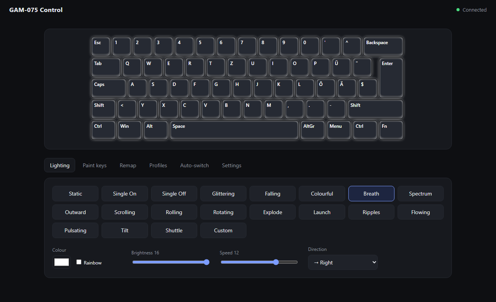

# GAM-075 Control

A small local app to control the Deltaco GAM-075 gaming keyboard without the
vendor software. Lighting, key remapping, profiles and per-app switching all
run from a web UI at `http://localhost:7075`.

The keyboard uses a Sonix chip (USB `05AC:0256`). I worked out the protocol
myself by watching what the Deltaco app sends, so this is unofficial and comes
with no warranty. It has only been tested on my own keyboard (60%, Swiss German
ISO layout).



## Features

- Lighting effects, colors and brightness, written straight to the keyboard
- Key remapping on the 144-slot matrix
- Saved profiles, plus automatic switching when a chosen app gets focus
- Tray icon (open the app, switch profile, toggle auto-switch, quit)
- Optional start with Windows
- LAN API with a token, so other tools (Home Assistant, a home server) can
  flash the keyboard as a notification
- Optional Claude Code hint: a local `POST /api/claude` (needs_you, done, clear)
  flashes the keys orange while Claude waits for you and green when it's done

## Requirements

- Windows 10 or 11
- Python 3.11 or newer
- A Deltaco GAM-075 plugged in over USB
- Close the Deltaco app first, both programs can't talk to the keyboard at once

## Quick start

```powershell
git clone https://github.com/itznotnelo/gam075.git
cd gam075
python -m venv .venv
.venv\Scripts\pip install -r requirements.txt
.venv\Scripts\python -m gam075
```

The browser opens `http://localhost:7075` on its own.

## LAN API

The UI and `/api/*` only answer requests from `127.0.0.1`. Calls from other
machines go to `/api/ext/*` and need the token shown in Settings, sent as an
`X-Token` header or a `token` query parameter.

- `status`: active profile, profiles, dark flag, writes today
- `notify?color=#ff0000&seconds=5`: flash the whole board, then restore
- `profile?name=...`: switch to a saved profile
- `dark?on=1` / `dark?on=0`: turn the board black and back. I use this with a
  Home Assistant automation on the smart plug at my desk. While it is dark,
  notifications are skipped and profile changes are saved for later.

## How the protocol works

Everything goes through 64-byte HID feature reports on interface 0. A write
looks like this:

1. `04 18` ready check
2. `04 ab` plus 64 random bytes, then `04 02` to unlock
3. `04 <block>` with the number of data packets, then the packets
4. `04 02` returns a 16-bit checksum of what the keyboard received
5. `04 f0` commits

`gam075/proto.py` has the details and `gam075/layout.py` maps every physical
key to its matrix slot.

## Project layout

| File | What it does |
| --- | --- |
| `gam075/proto.py` | Low-level HID protocol |
| `gam075/blocks.py` | Parse and build the lighting and keymap blocks |
| `gam075/engine.py` | Settings, profiles, notifications |
| `gam075/server.py` | Local web server and API |
| `gam075/watcher.py` | Per-app profile switching |
| `gam075/tray.py` | System tray icon |
| `gam075/autostart.py` | Start with Windows |

## License

MIT, see [LICENSE](LICENSE). Not affiliated with Deltaco or Sonix.
